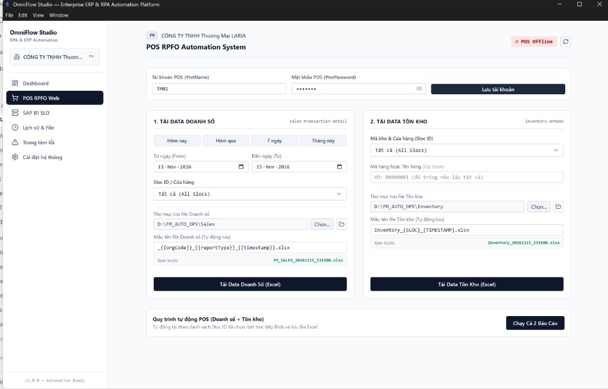
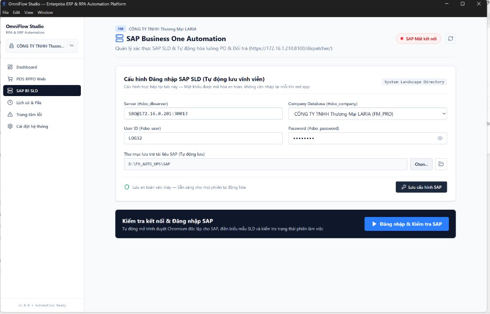
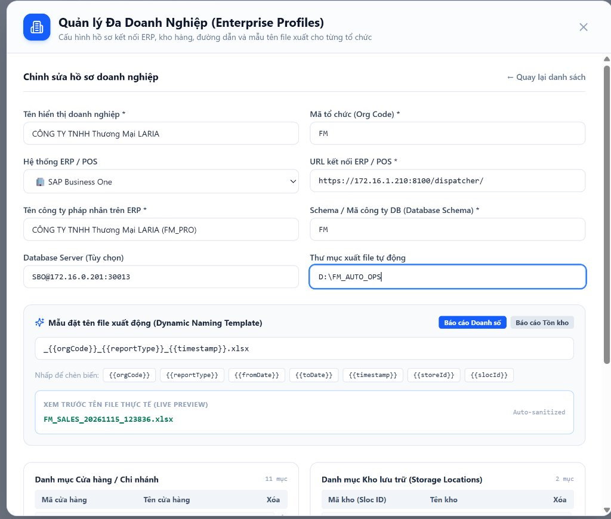

# OmniFlow Studio (v1.0.0)

<div align="center">


### **Nền tảng Tự động hóa & Trích xuất Dữ liệu ERP / POS Đa Doanh Nghiệp**

[](https://github.com/gochee-nhdk/OmniFlow-Studio/releases)
[](https://github.com/gochee-nhdk/OmniFlow-Studio)
[](https://github.com/gochee-nhdk/OmniFlow-Studio)
[](https://www.typescriptlang.org/)
[](https://github.com/gochee-nhdk/OmniFlow-Studio)

<p align="center">
  <b>Tự động hóa hoàn toàn quy trình đối soát dữ liệu bán lẻ POS RPFO và quản trị SAP Business One SLD.</b><br/>
  <i>Tăng tốc độ trích xuất dữ liệu, triệt tiêu sai sót thủ công và giám sát sức khỏe hạ tầng thời gian thực.</i>
</p>

</div>

---

## 📸 Giới Thiệu Trực Quan Giao Diện (Visual Interface Showcase)

OmniFlow Studio được thiết kế với giao diện Dark Mode phẳng hiện đại, trực quan, 0 độ trễ (zero delay), mang lại trải nghiệm làm việc mượt mà và trực quan cho người dùng doanh nghiệp.

### 1. Tự Động Hóa POS RPFO (Phần Chọn Ngày & Sloc ID Đa Chọn)
Giao diện phân hệ POS RPFO chuyên dụng với bộ chọn ngày linh hoạt (khoảng ngày hoặc ngày đơn), bộ lọc kho (Sloc ID) đa chọn trực quan, mẫu đặt tên file động và bảng ghi log thực thi thời gian thực.

<div align="center">
  
  <p><i>Hình 1: Bảng điều khiển tác vụ POS RPFO với bộ lọc mã kho Sloc và trình chọn ngày tự động</i></p>
</div>

---

### 2. Tự Động Hóa SAP Business One SLD (Cấu Hình Đăng Nhập & Xử Lý Trùng Phiên)
Phân hệ SAP Business One cho phép cấu hình đăng nhập tự động, tự chọn Company DB, kiểm tra tính sẵn sàng của phiên làm việc và kích hoạt cơ chế độc quyền **Take Over Session** (tự giải phóng phiên làm việc bị kẹt mà không cần can thiệp thủ công).

<div align="center">
  
  <p><i>Hình 2: Phân hệ SAP Business One SLD với tính năng kiểm tra đăng nhập và tự chiếm phiên làm việc</i></p>
</div>

---

### 3. Quản Lý Đa Doanh Nghiệp (Enterprise Profiles Multi-Tenant)
Hỗ trợ quản lý không giới hạn hồ sơ chi nhánh, thương hiệu hoặc công ty con. Người dùng có thể dễ dàng thiết lập thông tin xác thực riêng biệt, định dạng quy tắc xuất file (`namingTemplate`) và tùy biến danh sách cửa hàng/kho hàng áp dụng cho từng đơn vị.

<div align="center">
  
  <p><i>Hình 3: Trình quản lý cấu hình Enterprise Profiles đa công ty với chứng chỉ bảo mật độc lập</i></p>
</div>

---

### 4. Giám Sát Hạ Tầng Mạng & Kết Nối Thực Tế (Real Live Socket/HTTP Probing)
Hệ thống tích hợp bảng theo dõi sức khỏe kết nối mạng chủ động (Active Diagnostic Probing) với khả năng kiểm tra độ trễ (latency ping) liên tục đến cổng máy chủ SAP SLD và POS RPFO qua Socket/HTTP probing thực, giúp phát hiện sớm sự cố nghẽn mạng trước khi chạy tác vụ.

<div align="center">
  
  <p><i>Hình 4: Trình kiểm tra trạng thái mạng trực quan (Ping, Round-trip latency, Socket status)</i></p>
</div>

---

## 🌟 Tính Năng Cốt Lõi

### 1. Tự Động Hóa POS RPFO
- **Tải Data Doanh số tự động:** Hỗ trợ quét và trích xuất báo cáo doanh số theo từng ngày hoặc chuỗi ngày liên tục.
- **Tải Data Tồn kho đa điểm (Sloc ID):** Đồng bộ dữ liệu kho của toàn bộ chuỗi cửa hàng, kho tổng hoặc từng mã kho xác định chỉ với 1 cú click.
- **Wave Animation Retry & Smart Recovery:** Cơ chế tự động nhận diện trạng thái tải của giao diện DevExpress Web, tự hồi phục khi gặp nghẽn mạng hoặc timeout hệ thống, cam kết file xuất đầy đủ và toàn vẹn.

### 2. Tự Động Hóa SAP Business One SLD
- **Tự động đăng nhập & Điều hướng:** Tự động điền thông tin đăng nhập và điều hướng thẳng vào module nghiệp vụ cần trích xuất.
- **Tự động vượt cảnh báo trùng phiên (Take Over Session):** Tự phát hiện phiên làm việc đang hoạt động và chủ động Take Over mà không làm gián đoạn luồng tác vụ.
- **Bảo mật đa lớp tiêu chuẩn Enterprise:** Mật khẩu và thông tin tài khoản được mã hóa AES-256-GCM kết hợp phân vùng an toàn OS Vault (Windows Credential Manager / DPAPI), hoàn toàn không lưu trữ văn bản thuần (plain text).

### 3. Tùy Biến Đa Doanh Nghiệp (Enterprise Profiles)
- **Hỗ trợ không giới hạn hồ sơ doanh nghiệp:** Dễ dàng cấu hình và chuyển đổi qua lại giữa các công ty, thương hiệu hoặc chi nhánh khác nhau.
- **Cấu hình kho/cửa hàng linh hoạt:** Thêm, bớt, gán nhãn danh sách Sloc / Store ID một cách trực quan trên giao diện người dùng.
- **Đổi mẫu đặt tên file động (`namingTemplate`):** Hỗ trợ template linh hoạt dạng `{store}_{type}_{date}.xlsx` giúp phân loại báo cáo chuẩn xác, sẵn sàng nạp vào hệ thống BI hoặc kho lưu trữ kế toán.

### 4. Giao Diện Tối Giản, Siêu Tốc & Tối Ưu Tài Nguyên
- Thiết kế phẳng hiện đại, trực quan, 0 độ trễ (zero delay).
- Ứng dụng dồn 100% tài nguyên CPU/RAM cho động cơ tự động hóa Chromium Headless / Playwright, mang lại trải nghiệm mượt mà ngay cả trên máy trạm cấu hình phổ thông.

---

## 🚀 Hướng Dẫn Cài Đặt & Chạy Ứng Dụng

Người dùng có thể khởi chạy OmniFlow Studio theo một trong hai cách dưới đây:

### Cách 1: Tải Bản Đóng Gói (Khuyên Dùng Cho Người Dùng Cuối)
1. Truy cập mục **Releases** trên GitHub repository của dự án: [OmniFlow-Studio Releases](https://github.com/gochee-nhdk/OmniFlow-Studio/releases)
2. Tải về gói nén phiên bản mới nhất: `OmniFlow-Studio-v1.0.0-win64.zip`.
3. Giải nén thư mục tải về ra ổ đĩa máy tính (ví dụ: `D:\OmniFlow-Studio`).
4. Nhấp đúp vào file thực thi:
   ```text
   OmniFlow Studio.exe
   ```
   Ứng dụng sẽ tự động khởi động cùng toàn bộ dịch vụ ngầm đi kèm mà không cần cài đặt thêm môi trường phụ thuộc nào.

---

### Cách 2: Chạy Trực Tiếp Từ Mã Nguồn (Dành Cho Lập Trình Viên)
Yêu cầu môi trường: **Node.js (>= 18)** và **pnpm (>= 8)**.

1. **Clone repository:**
   ```bash
   git clone https://github.com/gochee-nhdk/OmniFlow-Studio.git
   cd OmniFlow-Studio
   ```

2. **Cài đặt các gói phụ thuộc:**
   ```bash
   pnpm install
   ```

3. **Build toàn bộ dự án:**
   ```bash
   pnpm run build
   ```

4. **Khởi chạy ứng dụng:**
   ```bash
   pnpm start
   ```

---

## ⚙️ Hướng Dẫn Cấu Hình Ban Đầu

Sau khi mở ứng dụng lần đầu tiên, hãy thực hiện các bước cấu hình sau:

1. **Kiểm tra kết nối mạng:**
   - Đảm bảo máy tính đã được kết nối vào mạng nội bộ công ty hoặc đã bật **VPN** nội bộ để truy cập được vào máy chủ POS RPFO và SAP SLD.
2. **Cấu hình hồ sơ & Tài khoản:**
   - Vào mục **Cài đặt (Settings)** $\to$ Chọn **Quản lý Hồ sơ Doanh nghiệp (Enterprise Profiles)**.
   - Nhập thông tin tài khoản đăng nhập (Username / Password) cho hệ thống POS và SAP. Dữ liệu này sẽ được mã hóa an toàn ngay lập tức.
3. **Chọn thư mục lưu trữ mặc định:**
   - Thiết lập đường dẫn thư mục xuất báo cáo (ví dụ: `D:\BaoCaoDoanhThu_TonKho`).
   - Tùy chỉnh quy tắc đặt tên file nếu muốn áp dụng mẫu riêng cho phòng ban kế toán.

---

## 🛠️ Kiến Trúc Dự Án (Repository Architecture)

```text
OmniFlow-Studio/
├── apps/
│   ├── local-agent/        # Core desktop runner & Chromium automation engine
│   └── web/                # Giao diện người dùng React + Tailwind CSS hiện đại
├── packages/
│   ├── browser-engine/     # Điều khiển Playwright / Chrome DevTools Protocol
│   ├── pos-adapter/        # Bộ chuyển đổi nghiệp vụ giao diện POS RPFO
│   ├── sap-adapter/        # Bộ chuyển đổi nghiệp vụ SAP Business One SLD
│   ├── security/           # Mã hóa AES-256 & Tích hợp OS Secure Vault
│   ├── file-engine/        # Xử lý, tổ chức và chuẩn hóa file Excel/CSV xuất ra
│   └── workflow-engine/    # Quản lý hàng đợi và điều phối luồng tác vụ song song
├── docs/
│   └── screenshots/        # Hình ảnh giao diện minh họa độ nét cao
└── assets/                 # Logo thương hiệu và tài nguyên đa phương tiện
```

---

## 🤝 Đóng Góp & Phát Triển

Dự án hoan nghênh mọi đóng góp cải tiến từ cộng đồng lập trình viên:
1. Fork dự án về tài khoản cá nhân.
2. Tạo nhánh tính năng mới (`git checkout -b feature/AmazingFeature`).
3. Cam kết các thay đổi (`git commit -m 'feat: Add AmazingFeature'`).
4. Đẩy nhánh lên repository (`git push origin feature/AmazingFeature`).
5. Tạo một **Pull Request** mô tả chi tiết nội dung đã hoàn thiện.

---

## 📄 Giấy Phép (License)

Dự án được phân phối dưới giấy phép nội bộ độc quyền của doanh nghiệp (Internal Proprietary License) hoặc tuân thủ giấy phép nguồn mở của tổ chức sở hữu. Mọi hành vi sao chép trái phép hoặc phát tán không qua ủy quyền đều bị nghiêm cấm.
