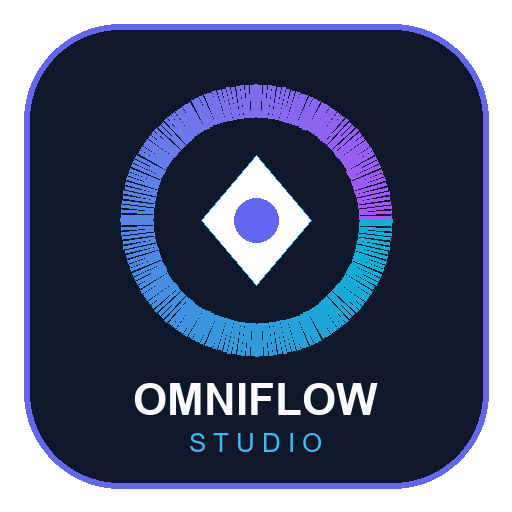
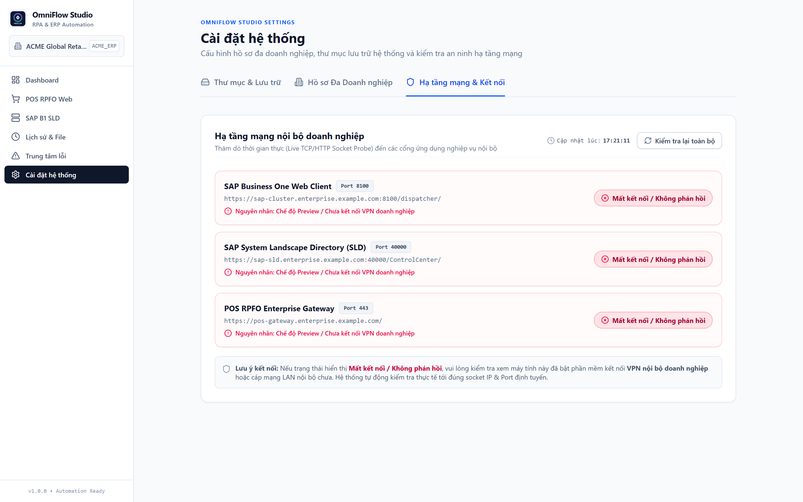

# 🚀 OmniFlow Studio (v1.0.0)

<div align="center">



### **Giải pháp Tự động hóa Trích xuất Dữ liệu ERP & POS Toàn diện cho Doanh nghiệp & Cá nhân**
*High-Performance Enterprise-Grade Automation Platform for SAP Business One & POS RPFO*

[](https://github.com/gochee-nhdk/OmniFlow-Studio/releases)
[](https://github.com/gochee-nhdk/OmniFlow-Studio)
[](https://github.com/gochee-nhdk/OmniFlow-Studio)
[](https://www.typescriptlang.org/)
[](https://playwright.dev/)
[](https://github.com/gochee-nhdk/OmniFlow-Studio)

<br/>

[](https://github.com/gochee-nhdk/OmniFlow-Studio/releases/download/v1.0.0/OmniFlow-Studio-v1.0.0-windows-x64.zip)
[](https://github.com/gochee-nhdk/OmniFlow-Studio/releases)

<p align="center">
  <b>Tự động hóa hoàn toàn quy trình đối soát dữ liệu bán lẻ POS RPFO và quản trị SAP Business One SLD.</b><br/>
  <i>Tăng tốc độ trích xuất dữ liệu, triệt tiêu 100% sai sót thủ công và giám sát sức khỏe hạ tầng thời gian thực.</i>
</p>

</div>

---

## ⚡ Tải Về Nhanh (Direct Download Links)

Người dùng có thể tải về bản cài đặt độc lập hoặc gói portable zip chạy ngay mà không cần cài đặt thêm môi trường:

| Gói phân phối (Distribution Package) | Nền tảng (Platform) | Trạng thái (Status) | Liên kết tải trực tiếp (Download Link) |
| :--- | :--- | :--- | :--- |
| **OmniFlow Studio Standalone Package (.zip)** | Windows x64 (10/11/Server) | Sẵn sàng (v1.0.0) | [👉 **Tải OmniFlow-Studio-v1.0.0-windows-x64.zip**](https://github.com/gochee-nhdk/OmniFlow-Studio/releases/download/v1.0.0/OmniFlow-Studio-v1.0.0-windows-x64.zip) |
| **Kho Lưu Trữ Phiên Bản (GitHub Releases)** | Toàn bộ phiên bản | Release Hub | [👉 **Xem Tất Cả Bản Phát Hành Tại Releases**](https://github.com/gochee-nhdk/OmniFlow-Studio/releases) |

---

## 📸 Giới Thiệu Trực Quan Giao Diện (Visual Interface Showcase)

OmniFlow Studio được thiết kế theo ngôn ngữ hiện đại, sắc nét độ phân giải cao, tối ưu 0 độ trễ (zero delay), mang lại trải nghiệm làm việc mượt mà và trực quan cho người dùng doanh nghiệp.

### 1. Tự Động Hóa POS RPFO (Phần Chọn Ngày & Sloc ID Đa Chọn)
Giao diện phân hệ POS RPFO chuyên dụng với bộ chọn ngày linh hoạt (khoảng ngày hoặc ngày đơn), bộ lọc kho (Sloc ID) đa chọn trực quan, mẫu đặt tên file động và bảng ghi log thực thi thời gian thực.

<div align="center">
  
  <p><i>Hình 1: Bảng điều khiển tác vụ POS RPFO với bộ lọc mã kho Sloc và trình chọn ngày tự động</i></p>
</div>

---

### 2. Tự Động Hóa SAP Business One SLD (Cấu Hình Đăng Nhập & Xử Lý Trùng Phiên)
Phân hệ SAP Business One cho phép cấu hình đăng nhập tự động, tự chọn Company DB, kiểm tra tính sẵn sàng của phiên làm việc và kích hoạt cơ chế độc quyền **Take Over Session** (tự giải phóng phiên làm việc bị kẹt mà không cần can thiệp thủ công).

<div align="center">
  
  <p><i>Hình 2: Phân hệ SAP Business One SLD với tính năng kiểm tra đăng nhập và tự chiếm phiên làm việc</i></p>
</div>

---

### 3. Quản Lý Đa Doanh Nghiệp (Enterprise Profiles Multi-Tenant)
Hỗ trợ quản lý không giới hạn hồ sơ chi nhánh, thương hiệu hoặc công ty con. Người dùng có thể dễ dàng thiết lập thông tin xác thực riêng biệt, định dạng quy tắc xuất file (`namingTemplate`) và tùy biến danh sách cửa hàng/kho hàng áp dụng cho từng đơn vị.

<div align="center">
  
  <p><i>Hình 3: Trình quản lý cấu hình Enterprise Profiles đa công ty với chứng chỉ bảo mật độc lập</i></p>
</div>

---

### 4. Giám Sát Hạ Tầng Mạng & Kết Nối Thực Tế (Real Live Socket/HTTP Probing)
Hệ thống tích hợp bảng theo dõi sức khỏe kết nối mạng chủ động (Active Diagnostic Probing) với khả năng kiểm tra độ trễ (latency ping theo mili-giây) liên tục đến cổng máy chủ SAP SLD và POS RPFO qua Socket/HTTP probing thực tế, giúp phát hiện sớm sự cố nghẽn mạng trước khi chạy tác vụ.

<div align="center">
  
  <p><i>Hình 4: Trình kiểm tra trạng thái mạng trực quan (Ping, Round-trip latency ms, Socket status)</i></p>
</div>

---

## 🌟 Điểm Nhấn Tính Năng Đột Phá (Feature Highlights)

### 🏢 1. Multi-Tenant Enterprise Profile (Tùy biến mọi loại hình doanh nghiệp, không giới hạn)
- **Quản lý không giới hạn hồ sơ:** Chuyển đổi linh hoạt giữa các tổ chức, công ty thành viên, thương hiệu bán lẻ hoặc chi nhánh độc lập.
- **Tùy biến danh mục kho & cửa hàng:** Thêm, sửa, kích hoạt hoặc vô hiệu hóa các mã kho (`Store ID`, `Sloc ID`) trực quan ngay trên giao diện.
- **Công thức đặt tên tệp thông minh:** Hỗ trợ cú pháp placeholder linh hoạt: `{{orgCode}}_{{reportType}}_{{fromDate}}_{{toDate}}.xlsx`.

### 🛒 2. POS RPFO Automation (Trích xuất doanh số, tồn kho đa kho, chống timeout)
- **Tải Data Doanh số tự động:** Hỗ trợ quét và trích xuất báo cáo doanh số chi tiết theo chuỗi ngày hoặc ngày đơn lẻ.
- **Tải Data Tồn kho đa điểm (Sloc ID):** Đồng bộ dữ liệu kho của toàn bộ chuỗi cửa hàng, kho tổng hoặc từng mã kho xác định chỉ với 1 cú click.
- **Cơ chế chọn kho thông minh:** Tự động điền chuỗi tham số `SFM0101; SFM0201; ...` vào lưới lọc của web POS, ngăn ngừa lỗi tràn bộ nhớ hoặc rớt kết nối.

### 💼 3. SAP Business One SLD Automation (Tự đăng nhập, giải quyết trùng phiên, bảo mật AES-256)
- **Tự động đăng nhập & Điều hướng:** Tự động xác thực qua System Landscape Directory (SLD) và điều hướng chuẩn xác vào phiên bản nghiệp vụ.
- **Độc quyền Take Over Session:** Tự động phát hiện và ngắt các phiên làm việc bị treo hoặc đang kẹt bởi người dùng khác, đảm bảo luồng chạy 24/7 không gián đoạn.
- **Bảo mật chuẩn Enterprise:** Mật khẩu và thông tin tài khoản được mã hóa chuẩn **AES-256-GCM** kết hợp phân vùng an toàn OS Vault (Windows DPAPI / Credential Manager), triệt tiêu hoàn toàn nguy cơ rò rỉ plain text.

### 🌐 4. Real Live Infrastructure Monitor (Đo độ trễ ms, socket handshake thực tế)
- **Active Diagnostic Probing:** Đo thời gian phản hồi (round-trip latency) tới cổng dịch vụ SAP (port 8100, 40000) và POS RPFO.
- **Socket Handshake Verification:** Kiểm tra kết nối TCP socket thực tế, hiển thị trạng thái `Online / Degraded / Offline` tức thì.

### 🔄 5. Adaptive Retry & Anti-Hang (Tự phục hồi khi đứt mạng/treo wave)
- **Wave Animation Guard:** Tự nhận diện trạng thái tải xoay vòng (loading spinner/wave animation) của lưới dữ liệu web, kiên nhẫn chờ dữ liệu render hoàn tất.
- **Adaptive Exponential Backoff:** Tự động retry theo lũy thừa thời gian khi phát hiện socket drop hoặc timeout tạm thời từ phía server.

---

## 🚀 Hướng Dẫn Cài Đặt & Chạy Ứng Dụng

### Cách 1: Chạy Bản Đóng Gói (Khuyên Dùng Cho Người Dùng Doanh Nghiệp)
1. Tải về file nén phiên bản mới nhất: [OmniFlow-Studio-v1.0.0-windows-x64.zip](https://github.com/gochee-nhdk/OmniFlow-Studio/releases/download/v1.0.0/OmniFlow-Studio-v1.0.0-windows-x64.zip).
2. Giải nén vào thư mục mong muốn (ví dụ: `D:\OmniFlow-Studio`).
3. Khởi chạy file thực thi:
   ```text
   OmniFlow Studio.exe
   ```
   Ứng dụng sẽ tự động tải giao diện người dùng và động cơ tự động hóa ngầm mà không cần cài đặt thêm bất kỳ thư viện nào khác.

---

### Cách 2: Chạy Từ Mã Nguồn (Dành Cho Nhà Phát Triển)
Yêu cầu: **Node.js (>= 20)** và **pnpm (>= 9)**.

1. **Clone repository:**
   ```bash
   git clone https://github.com/gochee-nhdk/OmniFlow-Studio.git
   cd OmniFlow-Studio
   ```

2. **Cài đặt các gói phụ thuộc:**
   ```bash
   pnpm install
   ```

3. **Build dự án:**
   ```bash
   pnpm run build
   ```

4. **Khởi chạy ứng dụng:**
   ```bash
   pnpm start
   ```

---

## ⚙️ Cấu Trúc Thư Mục Dữ Liệu Tự Động Hóa

Mặc định, ứng dụng lưu trữ và phân loại các tệp báo cáo xuất ra theo cấu trúc chuẩn hóa:
```text
D:\OmniFlow_Reports\
├── Inventory/    # Báo cáo tồn kho đa điểm (Inventory Onhand Excel)
├── Sales/        # Báo cáo chi tiết doanh số bán lẻ (Sales Detail Excel)
├── SAP/          # Tệp dữ liệu & nhật ký đồng bộ từ SAP Business One
└── PO/           # Đơn đặt hàng mua hàng tự động tạo (Purchase Orders)
```

---

## 🛠️ Kiến Trúc Hệ Thống (System Architecture)

```text
OmniFlow-Studio/
├── apps/
│   ├── local-agent/        # Core desktop runner & Chromium Playwright automation engine
│   └── web/                # Giao diện người dùng React 19 + Vite + Tailwind CSS
├── packages/
│   ├── browser-engine/     # Điều khiển Playwright / Chrome DevTools Protocol
│   ├── pos-adapter/        # Bộ chuyển đổi nghiệp vụ giao diện POS RPFO
│   ├── sap-adapter/        # Bộ chuyển đổi nghiệp vụ SAP Business One SLD
│   ├── security/           # Mã hóa AES-256-GCM & Windows DPAPI Keytar
│   ├── file-engine/        # Xử lý, tổ chức và chuẩn hóa file Excel/CSV xuất ra
│   ├── shared-types/       # Kiểu dữ liệu TypeScript dùng chung toàn bộ workspace
│   └── workflow-engine/    # Quản lý hàng đợi và điều phối luồng tác vụ song song
├── docs/
│   └── screenshots/        # Ảnh chụp màn hình độ nét cao, chuẩn hóa dữ liệu bảo mật
├── release/                # Bộ cài đặt & Gói đóng gói độc lập (.exe, .zip)
└── assets/                 # Logo thương hiệu và icon ứng dụng
```

---

## 🤝 Đóng Góp & Phát Triển

Mọi đóng góp từ cộng đồng đều được hoan nghênh:
1. Fork dự án về tài khoản cá nhân.
2. Tạo nhánh tính năng mới (`git checkout -b feat/tinh-nang-moi`).
3. Cam kết thay đổi (`git commit -m 'feat: them tinh nang moi'`).
4. Đẩy nhánh lên repository (`git push origin feat/tinh-nang-moi`).
5. Tạo **Pull Request** trên GitHub.

---

## 📄 Giấy Phép (License)

Phát hành theo giấy phép bản quyền của dự án OmniFlow Studio. Mọi quyền được bảo lưu.
